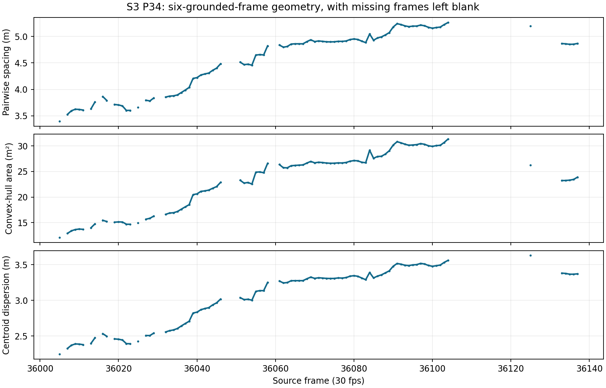

# Volleyball analytics thesis: research handoff

> **Repository note, 12 November 2026:** This is the earlier ZIP handoff retained for methods, provenance and disclosure context. The private GitHub repository omits the thesis manuscript and its PDF at the student's request. References below to a ZIP or thesis draft describe that earlier package; the current repository contains code and numerical evidence only.

**Michael Zervos · UTS Bachelor of Computing Science (Honours)**  
**Prepared:** 11 November 2026  
**Purpose:** A shareable index to the implementation, evidence, research-governance status and original rally-geometry figure. This is a project evidence handoff, not an ethics approval, supervisor endorsement or final thesis submission.

## Requested items at a glance

| Priority | Item | Provided here | Status |
| --- | --- | --- | --- |
| 1 — Essential | Project repository or ZIP | `HONOURS_VOLLEY_ANALYTICS_REVIEW_PACKAGE_2026-11-11.zip`, with code, requirements, primary-match machine-readable records, thesis evidence and figure | **Provided as a ZIP snapshot.** No GitHub remote was verified in this workspace. Raw match video and source-frame images are deliberately excluded. |
| 2 — Essential | Research ethics status | Section 2 and `DELIVERABLES/DATA_MANAGEMENT.md` | **Unconfirmed.** No UTS ethics approval, exemption or formal determination document was found in the project files inspected. The student/supervisor must supply the actual determination or record its status before claiming clearance. |
| 3 — Essential | AI use information | Section 3, with known uses and a student confirmation field | **Prepared, pending student attestation.** It identifies Codex-assisted coding, analysis and writing, an AI-assisted visual sequence pass, and human source-frame checks. It cannot establish every tool used outside this workspace. |
| 4 — Important | Original sample and annotation records | Section 4 and the ZIP's `data/matches/yt_u5HnY2aNW14/screening/` JSON/CSV records | **Provided.** The frozen 18-point score sample, eight included windows, four endpoint-uncertain windows, phase definitions and ground-contact rules are identified below. |
| 5 — Important | Original rally geometry figure | `DELIVERABLES/figures/u5_s3p34_reported_live_geometry.png` in the ZIP and reproduced in Section 5 | **Provided.** This is the actual 140-frame timeline with team metrics on 92 eligible frames, not an aggregate chart. |

## 1. Implementation and reproducibility

The primary source is the [Concordia–UCLA recording](https://www.youtube.com/watch?v=u5HnY2aNW14), locally decoded at **1280 × 720, 30 fps**. Its local MP4 SHA-256 is `da50eba82e7e9366eb7a93db169b42065dea790c3f335bf26397d9241a2f437b`. The ZIP contains the source manifest and annotations but **not the MP4**. Reproduction from video requires independently lawful access to the same source bytes; a different upload or transcode will not satisfy the stored hash.

The full-clip primary pass in `scripts/screen_u5_full_clip_tracks.py` samples every sixth source frame within each of 18 edited point clips (5 Hz). It calls Ultralytics YOLOv8n for person class `0` with `conf=0.20`, `imgsz=960`, `tracker='bytetrack.yaml'`, `persist=True`, and resets tracker state for each clip. The 30 fps run in `scripts/screen_u5_two_long_runs_30fps.py` uses the same detector/tracker settings. The later three-frame serve-opening screen in `scripts/screen_u5_s3p34_opening_frames.py` uses `predict`, `conf=0.15`, `imgsz=1280`, followed by provisional nearest-centre box-to-slot suggestions; those suggestions were source reviewed before being counted. Other experimental passes have their own settings in the relevant scripts and are not silently treated as this one run.

The installed Ultralytics `bytetrack.yaml` defaults observed for this environment are `track_high_thresh: 0.25`, `track_low_thresh: 0.1`, `new_track_thresh: 0.25`, `track_buffer: 30`, `match_thresh: 0.8`, and `fuse_score: true`. The local `yolov8n.pt` SHA-256 is `f59b3d833e2ff32e194b5bb8e08d211dc7c5bdf144b90d2c8412c47ccfc83b36`. Model weights are not in the share ZIP; verify the hash before attempting a numerical reproduction.

**Environment snapshot on 11 November 2026:** Python 3.11.2; Ultralytics 8.3.227; PyTorch 2.9.1+cpu; OpenCV 4.12.0; NumPy 2.1.3; SciPy 1.16.3; Matplotlib 3.10.7; FastAPI 0.115.5; Pydantic 2.9.2. `requirements.txt` pins the API baseline and `requirements-research.txt` adds the research packages. **The installed OpenCV 4.12.0 differs from the 4.10.0.84 baseline pin**; the environment snapshot describes the present installation, not a guaranteed historical version for every earlier run. Outputs contain input hashes for verification.

The staged court transform in `data/matches/yt_u5HnY2aNW14/screening/near_court_candidate.json` maps four image intersections to a 9 m × 9 m near-court square, with the near baseline at court `y=0` and net-floor line at `y=9`. Position proxies are translated or detected **box bottom centres**, not measured feet. The later refined transform is in `s3p34_calibration_review/refined_candidate.json`. A separate same-camera check on six out-of-point line marks has median residual **0.0261 m** and maximum **0.0397 m**; the originally frozen two-frame/twelve-mark rule was **not completed**. The [one-frame report](HONOURS_U5_S3P34_ONE_FRAME_CALIBRATION_DIAGNOSTIC.md) and [rally result](HONOURS_U5_S3P34_REPORTED_LIVE_INTERVAL_RESULT.md) state the resulting limits.

Reproduction entry points are the root `README.md`, `DELIVERABLES/HONOURS_U5_THESIS_FINAL_DRAFT.md` Section 7, the included scripts, requirements and primary-match JSON/CSV records. Manual review exports are source annotations: scripts should not regenerate or overwrite them. The ZIP is a source-and-evidence snapshot, not an executable copy of the local 293 MB source video or a claim that all intermediate data can be regenerated without it.

## 2. Ethics, source use and disclosure status

`DELIVERABLES/DATA_MANAGEMENT.md` is a **proposed procedure**. It expressly says it does not establish permission, ethics clearance, a retention period or configured access controls for the current video. An inspection of the project files found no UTS ethics approval letter, exemption notice or documented determination. This means the status is **not evidenced in the package**, rather than proof that no determination exists elsewhere.

The source is publicly accessible footage with identifiable athletes. Public access alone is not a recorded ethics or redistribution decision. The share ZIP omits raw video, source-frame crops and tracker contact sheets. Before wider sharing or library deposit, Michael and the supervisor should record the applicable UTS ethics determination and separately check rights for any identifiable video frame or image intended for distribution. The plot in Section 5 contains only numerical metrics and no player images.

**Student/supervisor completion field:** UTS ethics approval / exemption / other documented determination: **[insert reference, date and scope, or state “pending”]**. Footage and figure redistribution decision: **[insert decision and basis]**. Do not change this field to “approved” without the supporting record.

## 3. AI use and human verification

The following is a disclosure draft based on visible project evidence and this working session. Michael should confirm it and add any tools used elsewhere before submitting it as a personal declaration.

| Activity | Recorded AI/tool involvement | Human verification evidenced or still needed |
| --- | --- | --- |
| Coding and review websites | OpenAI Codex assisted with Python scripts, local review pages, debugging and documentation. YOLOv8n and ByteTrack performed automated person detection and association; they are algorithms under evaluation, not human reviewers. Any separate ChatGPT use outside this session must be added by Michael. | Script outputs and saved forms were checked against source-linked records in the project. Michael should confirm which generated code he inspected and ran. |
| Source-frame and identity review | An AI-assisted visual sequence pass examined 47 paired source/detector contact sheets for S3 P34; the thesis explicitly says this pass had no independent human adjudication. | Michael personally saved source-state/box-review forms for the 85 remaining 30 fps frames and three opening frames, checked the seven late #7 candidate boxes, and marked event/court frames. Some event statuses were batch entered from his statements rather than clicked individually. |
| Position reference and analysis | Scripts computed box-to-shoe discrepancies, court transforms, proxy eligibility, geometry, sensitivity scenarios and figures. Codex assisted with analysis code and report text. | Manual shoe positions and grounded/airborne judgments came from a single reviewer and remain qualified. No second blinded observer or independent positional ground truth is claimed. |
| Thesis writing | Codex assisted drafting, revising and formatting the thesis and this handoff. Any other writing assistant use should be added by Michael. | Michael must read the final thesis, verify every claim and citation, and accept responsibility for the submitted text. |

**Paste-ready disclosure for Michael to confirm or amend:** “I used OpenAI Codex to assist with software development, analysis scripts, figures and thesis drafting. YOLOv8n and ByteTrack generated candidate detections and IDs. An AI-assisted contact-sheet sequence check was used for part of the S3 P34 candidate identity audit and was not independently adjudicated. I personally reviewed and saved the source-frame annotations attributed to me, including player states, selected shoe marks, event judgments and court marks. [After checking: state what analyses, code and final writing I personally verified.] [Add any other AI tools, uses or exceptions here.]”

This declaration should not imply that every frame had an independently readable jersey digit, that AI output was independent ground truth, or that one reviewer supplied inter-observer reliability.

## 4. Original sample, windows and ground-position rules

The score-only 18-point sample was frozen with seed `20261102`: simple random selection without replacement of three displayed score changes per set and scoreboard winner side. Its original record is `data/matches/yt_u5HnY2aNW14/screening/rally_sample_score_only.json`. The selected points are:

| Set | Frozen point numbers |
| --- | --- |
| 1 | 5, 6, 18, 27, 34, 37 |
| 2 | 2, 6, 14, 26, 28, 37 |
| 3 | 11, 13, 23, 27, 33, 34 |

The eight **analysed** 0.8-second windows appear in `fixed_box_court_proxy_pilot.json`. Five instants are sampled at offsets −12, −6, 0, +6 and +12 frames around each anchor. Point numbering is **set number + within-set point number**, not video frame number.

| Set–point | Anchor source frame | Near-side phase | Near side won? |
| --- | ---: | --- | --- |
| S1 P5 | 1422 | Near defense | Yes |
| S1 P6 | 1758 | Near defense | No |
| S1 P18 | 5371 | Near defense | Yes |
| S2 P6 | 13566 | Near offense | No |
| S2 P28 | 19536 | Near offense | Yes |
| S3 P13 | 29940 | Near defense | Yes |
| S3 P27 | 34122 | Near defense | No |
| S3 P34 | 36072 | Near defense | No |

The four **endpoint-uncertain and excluded** windows are S1 P27 (anchor 7344, near-side/libero crossing), S2 P37 (anchor 22140, two near-side players converge), S3 P11 (anchor 29280, near attacker/far blocker net overlap), and S3 P33 (anchor 35844, front-row teammate/opponent net overlap). These reasons and their source-sheet hashes are in `box_centre_flow_audit.json`. Other visually clear candidates were also omitted during open-play and set/phase/outcome balancing; the final eight were availability selected and are not an unbiased rally sample.

The frozen phase definitions in `snapshot_phase_source_qc.json` are: **near defense**, when the far side appears to control or attack the ball and the near side prepares or responds; **near offense**, when the near side appears to control or attack and the far side defends or blocks; and **serve/reset**, when a serve or reset is apparent but an active exchange cannot be confirmed. Phase labels are visual context, not exact contact timestamps.

For a floor position, the project accepts a player only when identity, grounded state, matching box and plausible box-bottom floor proxy agree in that frame. A correct box may continue to follow an airborne player, but that player's floor coordinate remains **null**. Missing boxes, unclear contact and uncertain identity also remain null. The strict single-reviewer rules and their limits are in `DELIVERABLES/HONOURS_U5_S3P34_SINGLE_REVIEWER_PROTOCOL.md`; the full candidate-assisted review is in `s3p34_remaining_rally_review/completed.csv` and the three opening frames in `s3p34_opening_frame_review/completed.json`.

The 140-frame S3 P34 state record covers the reviewer-reported live interval 35998–36137. It contains **840 frame-player slots, 792 same-player candidate boxes, 774 accepted grounded proxies, and 92 frames with all six grounded proxies**. The last-live boundary came from a broad reviewer statement; the exact point-ending instant was not individually certified. The [geometry calculation](HONOURS_U5_S3P34_REPORTED_LIVE_GEOMETRY.md) leaves 48 incomplete team frames null and is descriptive, not an outcome-effect test.

## 5. Original rally geometry figure

This is the actual figure used for the 140-frame S3 P34 reported-live interval. Lines connect consecutive eligible frames; gaps are null where a player was airborne, missing or uncertain. Metrics use the exploratory refined same-camera transform on the 92 six-grounded frames.

**Original file:** `DELIVERABLES/figures/u5_s3p34_reported_live_geometry.png`. **Per-frame numbers:** `data/matches/yt_u5HnY2aNW14/screening/s3p34_reported_live_geometry.json`. The figure is a time series of geometric proxies, not a measured foot-travel plot or a causal outcome result.

## Handoff confirmation

Before external circulation, Michael should verify the student-specific ethics reference, the completeness of the AI-use disclosure, and the intended recipient's access to any third-party footage. The ZIP itself is designed to share code and numerical evidence without distributing the match video or identifiable source frames.
