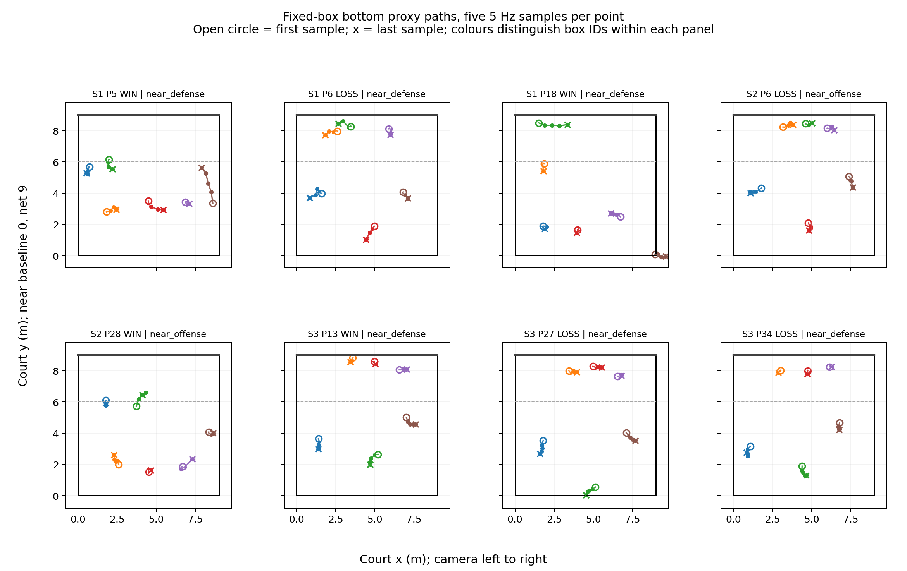

# Fixed-box court-position proxy pilot

This [source-bound pilot](../data/matches/yt_u5HnY2aNW14/screening/fixed_box_court_proxy_pilot.json) implements the proposed fixed-size player box. Each reviewed anchor box keeps its dimensions; optical flow translates its centre and its bottom-centre image point together. A staged 9 m floor homography maps that point to **approximate court metres**. The resulting paths are position proxies, not literal foot trajectories. The [five-instant source review](HONOURS_U5_FIVE_SAMPLE_SOURCE_REVIEW.md) found no obvious wrong-person transfer at the displayed samples.

The [print-ready figure](figures/u5_fixed_box_court_proxy_paths.pdf) shows five samples per player in each window. Open circles mark the first sample and crosses the last; these are fixed-box proxies, not manually marked feet.

The frozen sample contains 18 points. This pilot covers eight 0.8 s windows (four wins and four losses), three matched set-and-phase cells, 40 team-frame samples and 240 player-position proxies. 7/8 windows keep all six proxy positions inside the painted near-court square at every sample. Positions outside the lines are flagged and retained, not clamped.

| Metric | Win minus loss | One-point deletion range | Observed-error scenario range |
| --- | ---: | ---: | ---: |
| Mean pairwise spacing (m) | -0.089 | -0.307 to +0.130 | -0.431 to +0.158 |
| Formation hull area (m^2) | -4.212 | -5.984 to -2.440 | -7.547 to -1.064 |
| Centroid dispersion (m) | -0.104 | -0.226 to +0.018 | -0.326 to +0.062 |

| Short-window movement proxy | Win minus loss | One-point deletion range |
| --- | ---: | ---: |
| Median player first-to-last chord (m) | -0.069 | -0.140 to -0.001 |
| Median player sampled polyline (m) | -0.075 | -0.127 to +0.017 |

The JSON also records the within-cell exact label reference (18 possible assignments). This is **not a confirmatory p-value** because windows were selected by tracker availability. The error scenario shifts each proxy by up to the largest discrepancy in the earlier static clear-shoe reference (0.632 m) over 1,000 seeded draws; that observed value is not a bound for jumps or low posture. The 30 clear-shoe pairs assess related static box-bottom error. A subsequent [non-anchor audit](HONOURS_U5_DYNAMIC_SHOE_REFERENCE.md) finds 11 clear pairs and a larger 0.729 m maximum; its [updated sensitivity scenario](HONOURS_U5_DYNAMIC_ERROR_SENSITIVITY.md) uses that observation. Neither reference establishes an error bound or complete dynamic accuracy. The sampled chord and polyline lengths describe the proxy path, not actual foot travel or step count.

A [direct anchor-reference audit](HONOURS_U5_FIXED_BOX_ANCHOR_REFERENCE.md) joins 16 of these pilot player points to the existing manual clear-shoe marks. Two anchor frames have all six players labelled, enabling direct team-metric error checks. The non-anchor audit checks selected propagated positions. A later [one-frame full-team audit](HONOURS_U5_DYNAMIC_FULL_TEAM_REFERENCE.md) adds the remaining manual marks for one selected non-anchor frame; it does not validate the other propagated instants.

This is an operational prototype for RQ1/RQ2 and a descriptive, exploratory RQ3 comparison. It has no rotation metric or reliable performance effect. Posture, missingness and selection limits contribute to RQ4.

Reproduce with `python scripts/analyze_u5_fixed_box_court_proxy.py` after the short-flow and five-instant source reviews.
