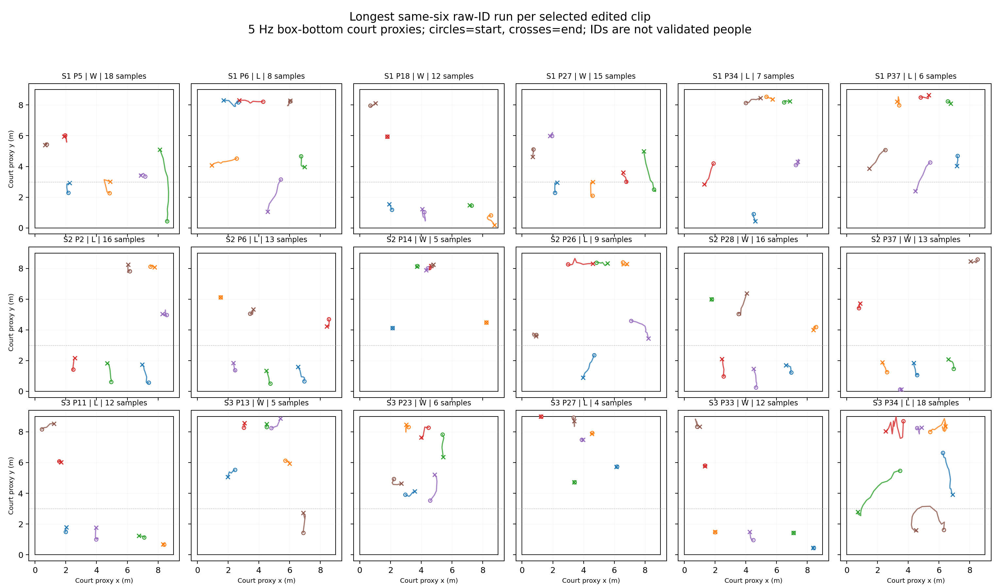

# Full selected-clip raw tracklet audit

The [source-bound JSON](../data/matches/yt_u5HnY2aNW14/screening/full_clip_tracklet_audit.json) segments point-local ByteTrack raw IDs across all 18 selected edited clips at 5 Hz. Each ID is split whenever it is missing at a sampled frame; gaps are not interpolated. A six-ID run requires exactly six distinct near-side geometric candidates at each consecutive sample.

The full pass has **1005** sampled clip frames and **348** exactly-six candidate frames. It yields **479** contiguous raw tracklet segments, of which **261** last at least five samples. The longest same-six-ID run is a candidate continuity diagnostic, not source-reviewed named-player identity.

| Set | Point | Near win | Full clip samples | Exactly six | Longest six-ID run, full clip | Longest six-ID run, coarse core |
| ---: | ---: | --- | ---: | ---: | ---: | ---: |
| 1 | 5 | Yes | 45 | 20 | 18 | 9 |
| 1 | 6 | No | 60 | 18 | 8 | 8 |
| 1 | 18 | Yes | 30 | 14 | 12 | 3 |
| 1 | 27 | Yes | 45 | 17 | 15 | 6 |
| 1 | 34 | No | 60 | 11 | 7 | 7 |
| 1 | 37 | No | 110 | 30 | 6 | 6 |
| 2 | 2 | No | 75 | 31 | 16 | 9 |
| 2 | 6 | No | 115 | 32 | 13 | 6 |
| 2 | 14 | Yes | 35 | 17 | 5 | 2 |
| 2 | 26 | No | 70 | 21 | 9 | 9 |
| 2 | 28 | Yes | 30 | 20 | 16 | 7 |
| 2 | 37 | Yes | 45 | 22 | 13 | 2 |
| 3 | 11 | No | 45 | 16 | 12 | 3 |
| 3 | 13 | Yes | 50 | 10 | 5 | 4 |
| 3 | 23 | Yes | 35 | 8 | 6 | 1 |
| 3 | 27 | No | 55 | 21 | 4 | 3 |
| 3 | 33 | Yes | 50 | 18 | 12 | 3 |
| 3 | 34 | No | 50 | 22 | 18 | 13 |

| Near team result | Clips | Sampled edit frames | Exactly-six candidates | Core runs of at least five samples |
| --- | ---: | ---: | ---: | ---: |
| Won | 9 | 365 | 146 | 3 |
| Lost | 9 | 640 | 202 | 7 |

These are availability diagnostics, not outcome estimates: edit length and phase differ, and geometric counts include wrong-team candidates.

At least five consecutive same-six-ID samples occur in 17/18 full edited clips and 10/18 conservative cores. Full-clip runs can begin in setup or end after the point. The tracker reset at the edit cut changes raw IDs relative to the earlier core-only pass, so ID numbers must not be compared between passes. The [coverage register](HONOURS_U5_SELECTED_CLIP_COURT_COVERAGE.md) preserves the earlier core-only screen as a separate diagnostic.

The [print-ready figure](figures/u5_full_clip_candidate_six_runs.pdf) shows the longest candidate run in each clip. Lines are box-bottom court proxies, circles mark first samples, and crosses mark last samples. This is a raw-ID visualization; a same-ID line can still switch people. A [bounded source-frame spot check](HONOURS_U5_FULL_CLIP_SPOTCHECK.md) finds no obvious identity transfer in the first, middle and last frames of the two longest runs. White jersey #28 is the near-side libero, not an opponent. Intervening identity remains unchecked.

**No full-rally six-player trajectory is validated** by these raw-ID segments. Jumps, net overlap, jersey similarity and unsampled frames can still cause identity or floor-position error. The result deepens the full-clip tracking audit without promoting candidate paths to accepted court metrics.

Reproduce with `python scripts/screen_u5_full_clip_tracks.py` and `python scripts/analyze_u5_full_clip_tracklets.py`.
