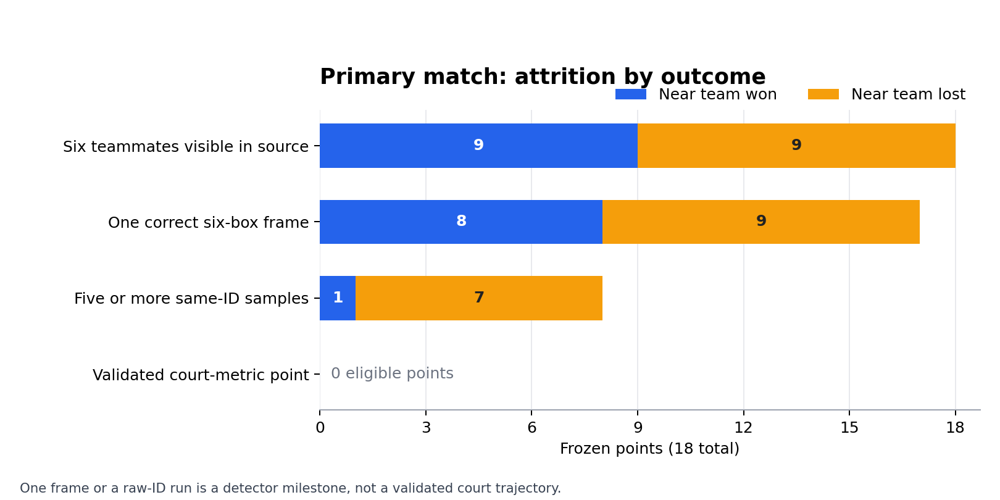

# Primary-match feasibility result

The primary Concordia–UCLA recording has **18 score-only frozen points**, selected before spatial inspection: three near-team wins and three losses in each of three sets. The [machine-readable result](../data/matches/yt_u5HnY2aNW14/screening/primary_feasibility_result.json) binds every stage to source hashes and retains all 18 points. This is an empirical feasibility result, not a completed court-metric outcome analysis.

| Set | Near team result | Frozen points | Six visible in source | Correct boxes, original pass | Correct boxes, any tested pass | ≥5 six-ID samples, original pass | Validated metric frames |
| ---: | --- | ---: | ---: | ---: | ---: | ---: | ---: |
| 1 | Won | 3 | 3 | 2 | 3 | 0 | 0 |
| 1 | Lost | 3 | 3 | 3 | 3 | 3 | 0 |
| 2 | Won | 3 | 3 | 2 | 3 | 0 | 0 |
| 2 | Lost | 3 | 3 | 3 | 3 | 3 | 0 |
| 3 | Won | 3 | 3 | 2 | 2 | 0 | 0 |
| 3 | Lost | 3 | 3 | 3 | 3 | 1 | 0 |



The [print-ready figure](figures/u5_primary_feasibility_attrition.pdf) is generated from the same source-hashed result. A six-ID run is still a detector milestone, not a validated court trajectory.

All **18/18** points show six near-side teammates at a source-reviewed instant; **15/18** had one locally correct six-box frame in the original detector pass. A higher-resolution, lower-threshold [source-checked recovery pass](../data/matches/yt_u5HnY2aNW14/screening/zero_run_high_res_source_qc.json) adds one correct instant in set-one point 18 and one in set-two point 14, bringing local six-box availability to **17/18** across tested settings. Set-three point 23 remains source-visible but its proposal boxes duplicate or merge overlapping players. None of the three has a recovered six-player trajectory. Longer six-ID runs occur in **7/18** points, all near-team losses. Source review finds correct team membership in 53 sampled frames across those seven longer runs, but only one run has named jersey continuity checked. Correct short winning runs cover five points; set-three point 33 has a rejected wrong-team run and a separate locally correct single frame.

A separate higher-resolution point-local tracking pass finds a [13-sample six-ID run in set-three point 13](../data/matches/yt_u5HnY2aNW14/screening/highres_winning_run_source_qc.json), a near-team win. Source review finds the same six UCLA teammates at all 13 sampled instants. The first five (0.8 s between first and last) appear active; later frames may include point-end movement. Across tested settings, this raises the number of points with at least five six-ID samples to **8/18: one win and seven losses**. Neither the early source phase nor the box-bottom floor positions are certified for final metric use. The one winning interval does not create a balanced rally-level outcome dataset.

The [eight-run motion diagnostic](HONOURS_U5_RUN_MOTION_DIAGNOSTIC.md) calculates the three implemented formulas on **66 sampled box-bottom proxy frames**, with no winner effect estimated. The winning run includes an airborne player in its early source frames, so its raw box bottoms cannot all be treated as grounded court coordinates. These diagnostic calculations contribute **zero validated metric frames**.

The [image-plane trajectory atlas](HONOURS_U5_RUN_TRAJECTORY_ATLAS.md) traces all six raw-ID box centres in the same 66 source-checked sampled instances, including the airborne player. It shows sampled image motion and the near-court outline, but most raw IDs have not been matched to named jerseys over unsampled frames. One of the eight longer runs, set-one point 34, has a serve/reset snapshot anchor; the other seven have open-play snapshot anchors, but their entire spans are not phase-certified. The only winning run uses the higher-resolution detector. The atlas is a reproducible tracking diagnostic, not six validated court trajectories.

A [short optical-flow pilot](HONOURS_U5_BOX_CENTRE_FLOW_PILOT.md) translates six reviewed source boxes through ±0.4 s around each of 17 anchors. It produces six image-plane candidates at all five 5 Hz samples for all 17. In 334 same-raw-ID comparisons, the median flow-to-detector centre difference is 5.10 px; this is correlated pipeline agreement, not independent accuracy. Source endpoint review finds 13 windows without an obvious wrong-person transfer and four with unresolved crossings or net overlap. After serve/reset and set-by-phase balancing, eight short windows remain candidate comparisons. None has manually certified named-player identity at every sample or validated court-floor positions, so the strict result remains zero.

A [five-sample image-plane geometry diagnostic](HONOURS_U5_FLOW_WINDOW_GEOMETRY.md) calculates the three spacing and spread formulas across those eight candidate windows (four wins, four losses). Its within-set-and-phase descriptive contrasts use pixel units and are sensitive to the sample time. The windows remain selected by box availability, and their intermediate identities and floor positions are not certified. These calculations do not establish a statistical winner association or meet the court-metric requirement.

A [five-instant source-image review](HONOURS_U5_FIVE_SAMPLE_SOURCE_REVIEW.md) inspected all eight candidate windows at their five displayed instants. No obvious wrong-person transfer was seen in these 40 displayed instances. This is a coarse visual screen: unsampled source frames, box-centre accuracy, named identities and court-floor positions remain unvalidated. One window has a player outside the sideline, and another has a low posture near the net. The strict court-trajectory result remains zero.

A [one-point deletion audit](HONOURS_U5_FLOW_WINDOW_SENSITIVITY.md) shows that the descriptive pixel contrasts change substantially with selected-point removal: spacing ranges from +12.306 to +59.268 px, hull area from -14588.302 to -1744.800 px², and dispersion from +8.252 to +40.070 px. Deleting the set-two winning window removes that entire matched phase cell. These ranges are selection checks, not uncertainty intervals or court-metric effects.

A [fixed-box court-position proxy pilot](HONOURS_U5_FIXED_BOX_COURT_PROXY.md) now operationalizes the proposed research-prototype measurement: each anchor box retains its size, optical flow translates its centre and bottom point, and the bottom point is mapped through the staged 9 m homography. It yields 240 approximate court-position proxies across 40 sampled team frames in eight short windows. The three planned geometry formulas run on those positions, with one-point deletion and observed-error perturbation checks. These are reported as exploratory approximate-court results. The 30 clear-shoe reference pairs measure related static box-bottom error; dynamic propagated floor accuracy, rotation, and comparable full-rally trajectories remain unresolved.

The same pilot also measures short-window proxy movement: median player first-to-last chord and sampled polyline length. Equal-cell winning-minus-losing differences are -0.069 m and -0.075 m, respectively; the one-point deletion range for the sampled polyline spans zero. These are movement of the **estimated box-floor points**, not counted steps, actual foot travel, or a transition-speed effect.

A [direct anchor-reference audit](HONOURS_U5_FIXED_BOX_ANCHOR_REFERENCE.md) matches 16 of the new pilot player points to existing manual clear-shoe marks on three source frames. Two frames contain all six marked teammates, allowing direct team-metric discrepancy calculations. The median matched player-position difference is 0.277 m and the maximum is 0.632 m. This reuses the existing single-reviewer reference; it does not validate propagated positions away from the anchor.

A [non-anchor manual audit](HONOURS_U5_DYNAMIC_SHOE_REFERENCE.md) checks selected fixed-box positions 12 frames away from each anchor. Eleven clear grounded shoe pairs could be marked across all eight windows; five selected slots remain missing because the shoes or contact were uncertain. The median mapped difference is 0.216 m and the largest is 0.729 m, above the earlier static maximum. A [revised error scenario](HONOURS_U5_DYNAMIC_ERROR_SENSITIVITY.md) perturbs the 240 proxies using the new observed maximum. Spacing and dispersion contrasts cross zero in those draws; hull area remains negative in the simulated draws, which does not establish a winner effect.

The [one-frame full-team non-anchor check](HONOURS_U5_DYNAMIC_FULL_TEAM_REFERENCE.md) adds four manual marks to two of the above marks at set-three point 13, frame 29952. All six selected near-side players have an approximate shoe midpoint there. Median player-position discrepancy is 0.468 m; fixed-box minus manual team spacing is +0.431 m, hull area +4.190 m² and dispersion +0.308 m. This single selected clear frame does not validate the other instants of that window, full rallies or the outcome contrast.

An earlier [core-only coverage export](HONOURS_U5_SELECTED_CLIP_COURT_COVERAGE.md) records every 5 Hz grid instant within all 18 frozen point clips. Across 1,005 grid instants, 370 were not part of that saved dense screen, 421 had fewer than six near-side candidates, 206 had exactly six raw box-bottom court candidates, and eight had more than six ambiguous candidates. The export retains these states and the available coordinates without inventing missing players. These 206 candidate frames are not validated six-player positions or certified live rallies; the strict metric count remains zero.

A subsequent [full-clip tracking pass](HONOURS_U5_FULL_CLIP_TRACKLET_AUDIT.md) screens all 1,005 grid instants after resetting ByteTrack at each edited clip. It finds 348 exactly-six near-side geometric candidate frames and 479 contiguous raw-ID tracklet segments. Seventeen clips contain at least five consecutive samples with the same six raw IDs somewhere in the full edit, but only ten do so within the conservative core. These counts use a different tracker start from the earlier core-only export, so the two candidate totals and raw IDs are separate diagnostics. The [candidate-path figure](figures/u5_full_clip_candidate_six_runs.png) shows the longest six-ID run in each clip. A [bounded source-frame spot check](HONOURS_U5_FULL_CLIP_SPOTCHECK.md) finds no obvious transfer at the first, middle and last frames of the two longest runs. White #28 in set-three point 34 is the near-side libero, not a far-side opponent. The intervening frames, exact live phase and grounded court positions remain unchecked; no full-rally six-person court trajectory has been validated from this pass.

An [expanded every-sample identity review](HONOURS_U5_FULL_RUN_IDENTITY_AUDIT.md) checks all 18 sampled frames and six player crops in each of those two runs: 36 team frames and 216 person crops. Each raw ID stays with the same visible UCLA jersey at the sampled instants, with no obvious sampled identity switch. Five source frames between each pair of 5 Hz samples remain unchecked. A [direct in-run position comparison](HONOURS_U5_FULL_RUN_POSITION_REFERENCE.md) reuses two manual clear-shoe marks at set-three point 34 frame 36084; the current box-bottom discrepancies are 0.216 m and 0.523 m. These selected single-frame errors show that correct jersey identity does not imply exact court position. The full-rally trajectory gate remains open.

A separate [30 fps screen of both long runs](HONOURS_U5_TWO_RUNS_30FPS_AUDIT.md) checks every decoded source frame inside their 103-frame spans. Set-one point 5 has six near-side candidates with the same raw IDs in 103/103 frames. Set-three point 34 has six in 93/103 frames, with ten temporary missing detections affecting UCLA #7 and #21; the same ID values reappear, and no new near-side raw ID is introduced. Source-image review finds those missing teammates visible but unboxed at all ten frames. This dense raw-ID pass does not provide a human jersey check at every frame, and the missing positions are left blank rather than held still. Neither span has a certified exact live-rally boundary or complete grounded-position reference.

An [extended full-rally validation audit](HONOURS_U5_FULL_RALLY_TRAJECTORY_VALIDATION.md) screens source frames through reviewed point-end brackets. From each conservative live start through the last reviewed live frame, the original six raw IDs all have boxes in 63/108 frames at S1 P5 and 96/138 frames at S3 P34. These intervals do not certify exact serve or dead-ball frames. A later [S3 P34 source review](HONOURS_U5_S3P34_SOURCE_VALIDATION_PROGRESS.md) corrects UCLA #7's late tracker change from ID 9 to ID 78, excludes a far-side ID 39, and keeps airborne or missing positions null. Eleven of 24 sampled 5 Hz frames have exploratory six-grounded-player proxy metrics. Five [six-player manual shoe reference frames](HONOURS_U5_LIVE_SIX_PLAYER_REFERENCE.md) distributed through S3 P34 have 0.298 m median box-bottom discrepancy across 30 positions and 0.595 m maximum; three added frames are unblinded single-reviewer checks. The evidence remains insufficient to validate a complete six-player court trajectory or final metric input.

A [same-set matched-window pilot](HONOURS_U5_MATCHED_WINDOW_PILOT.md) then compared one winning and one losing point over equal 0.8 s sample spans. All displayed frames have six screen-space box-centre candidates, including airborne frames. The fixed first-run windows failed phase matching for an outcome comparison. A revised opponent-attack candidate improved phase similarity but was selected after inspecting source phases, and one point per outcome is insufficient for a reliable association. Neither attempt certified six-player floor anchors for metre-valued court metrics. **Neither attempt produced an eligible outcome-analysis window.**

An [18-point image-plane snapshot screen](HONOURS_U5_IMAGE_PLANE_SNAPSHOT_SCREEN.md) calculates box-centre geometry for 17 locally reviewed six-player frames, including the two higher-resolution recoveries. One winning point remains missing. An [exact-frame source phase audit](HONOURS_U5_SNAPSHOT_PHASE_BALANCE.md) identifies eight near-side defensive frames, seven offensive frames, and two serve/reset frames. Only 13/18 frozen points fall in open-play set-by-phase cells with both outcomes; each cell has at most two snapshots per outcome. The original 15-frame and augmented 17-frame within-set contrasts are descriptive sensitivity checks selected by box availability. No significance test or court-metric outcome effect is inferred from these pixel values.

An [exploratory phase-matched court-proxy calculation](HONOURS_U5_PHASE_MATCHED_PROXY.md) projects box bottoms for those 13 single frames through the staged 9 m transform. Across five set-and-phase cells, the equal-cell mean win-minus-loss spacing is +0.104 m, hull area +0.309 m^2 and dispersion +0.032 m. Removing the one matched high-resolution recovery reverses all three signs; perturbing each proxy by up to the largest observed clear-shoe discrepancy also spans zero for each metric. These data are selected snapshots, not validated trajectories or a reliable statistical winner association. The strict court-metric result remains zero.

Static floor-image registration succeeds on **24** reviewed frames across all 18 points, with at most 0.293 px fitted landmark displacement. A 30-box clear-shoe reference finds a largest observed box-bottom to shoe-midpoint discrepancy of **0.632 m**; this is not a validated bound and excludes unclear contacts. The [snapshot sensitivity audit](../data/matches/yt_u5HnY2aNW14/screening/selected_proxy_sensitivity.json) probes the resulting metric instability, but its winner medians are selected single frames and are not outcome estimates.

## Decision under the signed question

The strict six-player court-metric input has **0 validated frames and 0 validated rallies or fixed analysis windows**. Thus the prespecified within-set outcome association is **not estimable**. This is missing measurement evidence, not evidence of no association. The edited clip cuts and conservative live-looking interiors remain navigation boundaries; exact events, continuous six-person identity and grounded positions are unverified. Camera-image stability alone cannot clear those gates.

The reproducible contribution now includes score-balanced selection, source-visible roster accounting, detector attrition by outcome, stable image registration, a bounded shoe-proxy discrepancy check, three implemented metric formulas and explicit exclusion of unsupported inference. The signed contract's validated trajectories and outcome comparison remain outstanding. A feasibility-focused thesis would require the academic scope decision described in [the decision draft](HONOURS_SCOPE_DECISION_DRAFT.md).

## Reproduction

```powershell
.\.venv\Scripts\python.exe scripts/build_u5_primary_feasibility_result.py
.\.venv\Scripts\python.exe scripts/plot_u5_primary_feasibility.py
```
