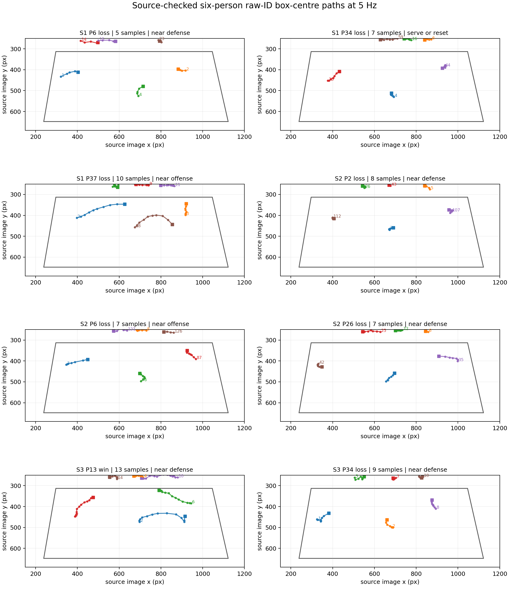

# Source-checked image-plane trajectory atlas

The [print-ready PDF](figures/u5_run_box_centre_trajectory_atlas.pdf) and [source-bound coordinate record](../data/matches/yt_u5HnY2aNW14/screening/run_box_centre_trajectory_atlas.json) show the **66 sampled frame instances** from eight runs with six visually correct near-side teammates at every displayed 5 Hz sample. Each coloured line follows one raw tracker ID by the centre of its image box; the square marks its first sample. The outlined quadrilateral is the near court in the source image. Airborne players remain valid screen-space box centres. Several front-row centres plot above the floor-plane net line because body centres are elevated; that visual gap is why the centres are not projected through the floor homography.

| Set | Point | Result | Samples | Span (s) | Median raw-ID polyline (px) | Largest sample step (px) | Phase at selected snapshot |
| ---: | ---: | --- | ---: | ---: | ---: | ---: | --- |
| 1 | 6 | Lost | 5 | 0.80 | 71.31 | 32.50 | near defense |
| 1 | 34 | Lost | 7 | 1.20 | 37.12 | 23.76 | serve or reset |
| 1 | 37 | Lost | 10 | 1.80 | 69.38 | 35.85 | near offense |
| 2 | 2 | Lost | 8 | 1.40 | 23.59 | 15.09 | near defense |
| 2 | 6 | Lost | 7 | 1.20 | 59.86 | 39.00 | near offense |
| 2 | 26 | Lost | 7 | 1.20 | 45.56 | 30.62 | near defense |
| 3 | 13 | Won | 13 | 2.40 | 153.02 | 44.96 | near defense |
| 3 | 34 | Lost | 9 | 1.60 | 56.83 | 26.54 | near defense |

The polyline sums only observed 0.2 s sample-to-sample image displacements. It is **not court movement distance** and can underestimate motion between samples. One run (set one, point 34) has a serve/reset snapshot; the whole-run live phase is not certified. There is only one winning run, from a different detector pass. Source review checked team membership at sampled frames, not every intervening video frame or named jersey identity for every path. These lines are candidate trajectories for evaluation, not validated court trajectories or outcome effects.

Reproduce with `python scripts/build_u5_run_trajectory_atlas.py`.
