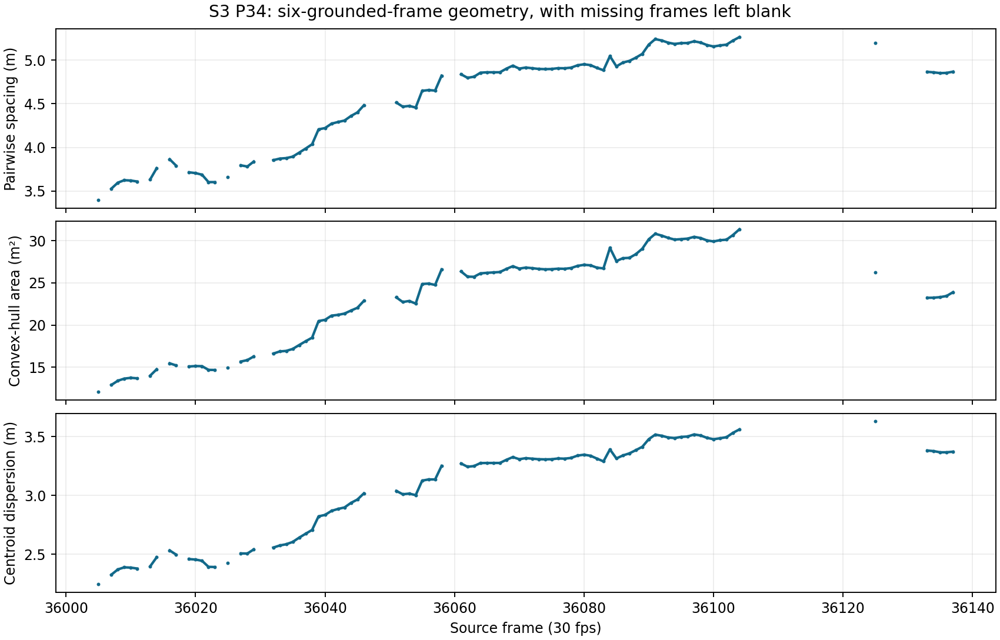

# S3 P34 exploratory rally-long team geometry

The [joined 140-frame state review](HONOURS_U5_S3P34_REPORTED_LIVE_INTERVAL_RESULT.md) has **92 frames with six accepted grounded box-bottom proxies**. The other 48 frames have null team metrics. The three team measures were calculated on those 92 frames using the post-review refined court transform. Its [one-frame out-of-point diagnostic](HONOURS_U5_S3P34_ONE_FRAME_CALIBRATION_DIAGNOSTIC.md) has six small court-line residuals but does not pass the frozen two-frame rule. This is therefore an exploratory same-camera geometry series, not a formally approved strict metric input.

| Measure | Median | Observed range | Median absolute change from staged transform |
| --- | ---: | ---: | ---: |
| Pairwise spacing | 4.853 m | 3.401–5.263 m | 0.052 m |
| Convex-hull area | 25.314 m² | 12.072–31.343 m² | 0.595 m² |
| Centroid dispersion | 3.275 m | 2.245–3.629 m | 0.034 m |

Gaps in the plot are frames with an airborne, missing or uncertain floor position. Values are geometric descriptions of six proxies, not reachable defensive area, rotation, measured foot travel or evidence that the rally outcome was caused by a formation. The last-live boundary rests on a broad single-reviewer statement; all player checks were candidate assisted. [Machine-readable per-frame metrics and source hashes](../data/matches/yt_u5HnY2aNW14/screening/s3p34_reported_live_geometry.json).
